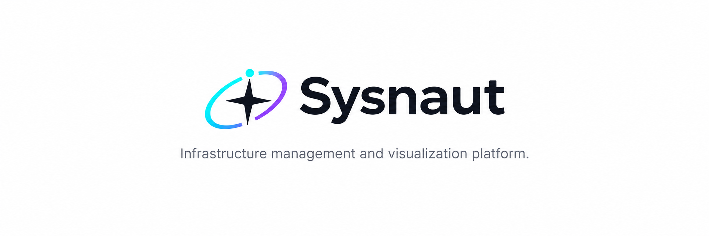

# Sysnaut

Infrastructure management and visualization platform for modeling topologies, discovering resources, managing remote connections, and operating physical and virtual infrastructure.

## About

Sysnaut aims to provide a unified environment for understanding, accessing, and managing infrastructure, from individual devices and homelabs to complex physical, virtual, and cloud environments.

The project is currently in its early stages of design and development.

## Support the project

Sysnaut is an independent Free and Open Source Software project.

If you believe infrastructure management tools should be open, accessible, extensible, and independent of proprietary ecosystems, consider supporting its development.

Your support helps fund development, maintenance, documentation, testing infrastructure, and the continued evolution of the project.

[**Become a sponsor on GitHub**](https://github.com/sponsors/guesant)

## License

This project is Free Software: You can use, study, share and improve it at your will. Specifically, you can redistribute and/or modify it under the terms of the [GNU Affero General Public License version 3](https://www.gnu.org/licenses/agpl-3.0.html) as published by the Free Software Foundation.

See [LICENSE](LICENSE) for details.

Third-party software and materials remain subject to their respective licenses and terms of use.
